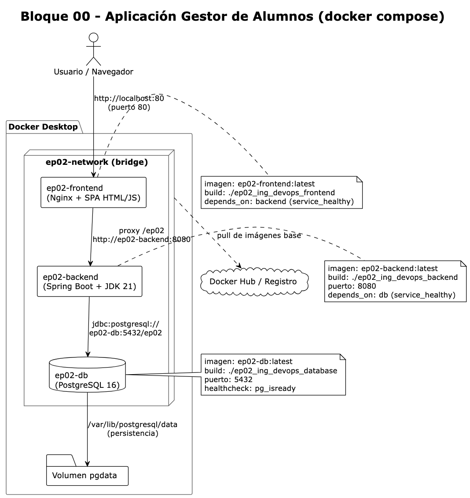

# Ejecución Local - Gestor de Alumnos

## Requisitos Previos

1. **Docker Desktop** debe estar instalado y ejecutándose
2. Verificar que Docker esté corriendo (ícono verde en la barra de tareas)

## Estructura del Proyecto

```
bloque00-aplicacion/
├── database/     # PostgreSQL 16
├── backend/      # Spring Boot + JDK 21
└── frontend/     # Nginx + SPA (HTML/JS)
```

## Inicializar los Servicios

**IMPORTANTE:** Ejecutar en este orden específico:

### Paso 1: Base de Datos

```bash
cd ep02_ing_devops_database
docker compose up -d
```

Esperar hasta que el contenedor esté verde en Docker Desktop.

### Paso 2: Backend

```bash
cd ../ep02_ing_devops_backend
docker compose up -d
```

Esperar hasta que el contenedor esté verde en Docker Desktop.

### Paso 3: Frontend

```bash
cd ../ep02_ing_devops_frontend
docker compose up -d
```

Esperar hasta que el contenedor esté verde en Docker Desktop.

## Verificar en Docker Desktop

Abrir Docker Desktop y verificar que los 3 contenedores estén en estado **Running** (verde):

| Contenedor    | Puerto | Estado esperado |
| ------------- | ------ | --------------- |
| ep02-db       | 5432   | Running (verde) |
| ep02-backend  | 8080   | Running (verde) |
| ep02-frontend | 80     | Running (verde) |

## Probar la Aplicación

Abrir el navegador y ejecutar:

**http://localhost**

Verás la interfaz del Gestor de Alumnos con la lista de productos.

## Endpoints Disponibles

| Servicio | URL                        | Descripción          |
| -------- | -------------------------- | --------------------- |
| Frontend | http://localhost           | Interfaz web          |
| Backend  | http://localhost:8080/ep02 | API REST              |
| Database | localhost:5432             | PostgreSQL (solo red) |

# Solución de Problemas

### Backend no conecta a la DB

- Verificar que `ep02-db` esté corriendo y verde
- Verificar logs: `docker compose logs ep02-db`

### Frontend no muestra datos

- Verificar que `ep02-backend` esté corriendo
- Verificar logs: `docker compose logs ep02-backend`
- Abrir consola del navegador (F12) para ver errores

### Puerto 80 ocupado

- Cambiar el puerto en `frontend/docker-compose.yml`:
  ```yaml
  ports:
    - "8080:80"  # Acceder en http://localhost:8080
  ```

### Puerto 5432 ocupado

- Cambiar el puerto en `database/docker-compose.yml`:
  ```yaml
  ports:
    - "5433:5432"  # Conectar en localhost:5433
  ```

## Diagrama de Arquitectura

```
┌─────────────────────────────────────────────────────────────┐
│                    Docker Desktop                            │
├─────────────────────────────────────────────────────────────┤
│                                                              │
│  ┌──────────────┐    ┌──────────────┐    ┌──────────────┐   │
│  │  Frontend    │    │   Backend    │    │   Database   │   │
│  │  (Nginx)     │───▶│ (Spring Boot│───▶│ (PostgreSQL) │   │
│  │  :80         │    │  :8080)      │    │  :5432       │   │
│  └──────────────┘    └──────────────┘    └──────────────┘   │
│         │                   │                   │            │
│         └───────────────────┴───────────────────┘            │
│                     ep02-network                          │
└─────────────────────────────────────────────────────────────┘
                          │
                          ▼
                    http://localhost
```




## Para remover todo lo hecho con Docker

```
bash remove-docker-app.sh
```

## Versión Docker Compose

Ahora en vez de ir por cada uno de los servicios, ahora probaremos con Docker Compose

```
docker compose up -d
```

## Remover los componentes de Docker Compose

```
bash remove-docker-compose-app.sh
```
