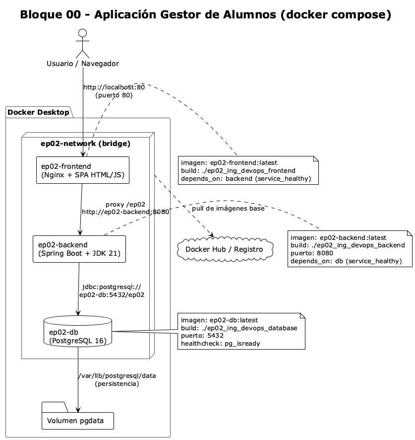
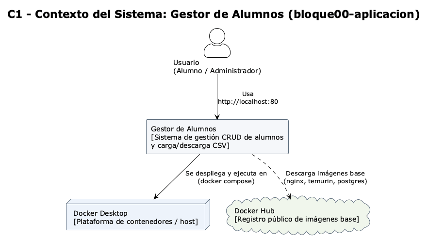
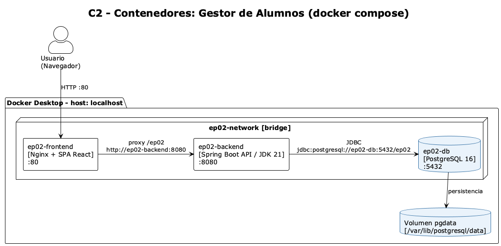
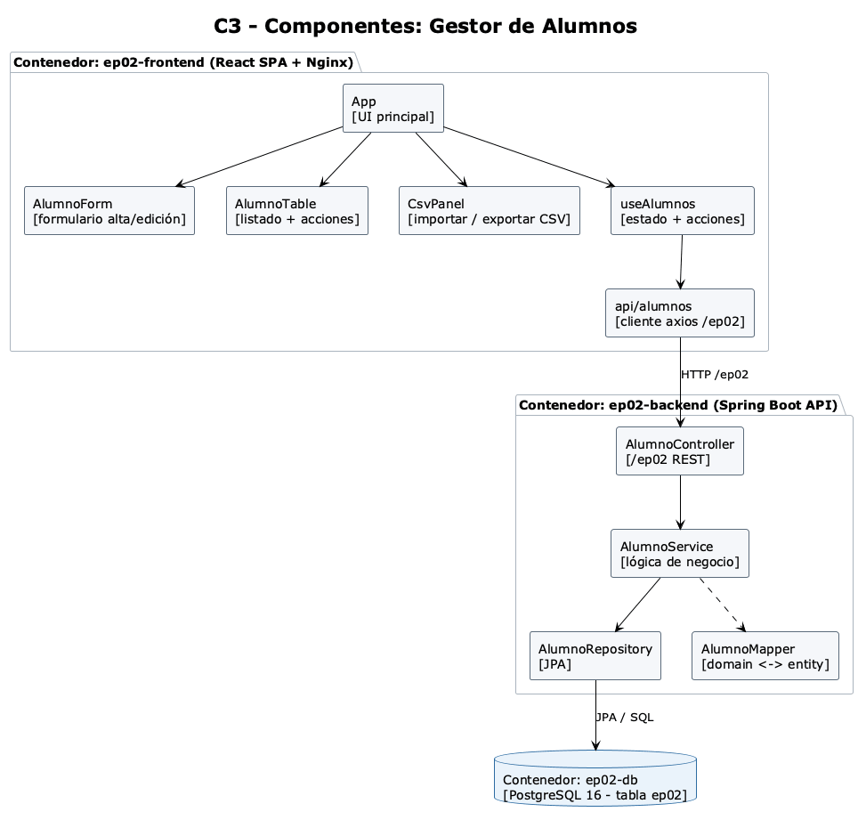
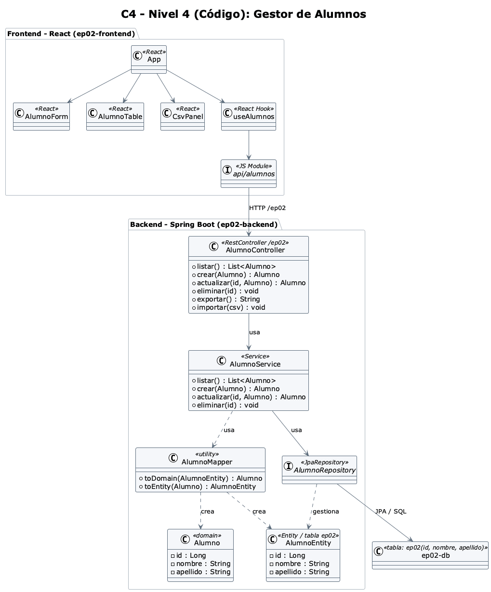
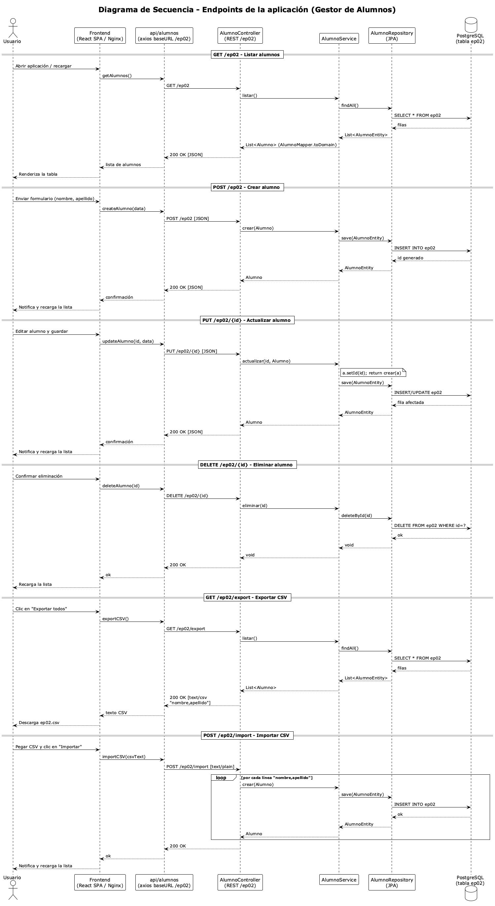

# Diseño de la Arquitectura — Gestor de Alumnos

Documento que describe la arquitectura de la solución del **bloque00-aplicacion**, una aplicación
de 3 capas (frontend, backend y base de datos) empaquetada y ejecutada con **Docker Compose**.

---

## 1. Descripción general

La solución es un **CRUD de alumnos** con carga/descarga de CSV, compuesto por tres contenedores:

- **Frontend**: SPA en React servida por Nginx (puerto 80).
- **Backend**: API REST en Spring Boot / JDK 21 (puerto 8080), ruta base `/ep02`.
- **Base de datos**: PostgreSQL 16 (puerto 5432), tabla `ep02`.

Los tres se comunican por una red Docker (`ep02-network`) y la base de datos persiste en el
volumen `pgdata`.

---

## 2. Vista de despliegue (docker compose)



El archivo `docker-compose.yml` orquesta el arranque en este orden:

1. **ep02-db** (`ep02-db:latest`) — se espera su `healthcheck` (`pg_isready`).
2. **ep02-backend** (`ep02-backend:latest`) — arranca con `depends_on: db (service_healthy)`.
3. **ep02-frontend** (`ep02-frontend:latest`) — arranca con `depends_on: backend (service_healthy)`.

Nginx del frontend hace de proxy interno de `/ep02` hacia `http://ep02-backend:8080`, por lo que
el navegador solo necesita acceder a `http://localhost:80`.

---

## 3. Modelo C4

### C1 — Contexto del sistema



El actor **Usuario** (alumno/administrador) interactúa por `http://localhost:80`. El sistema se
despliega sobre **Docker Desktop** y descarga sus imágenes base desde **Docker Hub**.

### C2 — Contenedores



- `ep02-frontend` (Nginx + React) expone el puerto **80**.
- `ep02-backend` (Spring Boot) expone el puerto **8080**.
- `ep02-db` (PostgreSQL 16) expone el puerto **5432** y persiste en el volumen `pgdata`.
- Todo dentro de la red **ep02-network (bridge)**.

### C3 — Componentes



Componentes internos de cada contenedor:

- **Frontend**: `App`, `AlumnoForm`, `AlumnoTable`, `CsvPanel`, el hook `useAlumnos` y el cliente
  `api/alumnos` (axios con `baseURL=/ep02`).
- **Backend**: `AlumnoController` (`/ep02`), `AlumnoService` (lógica), `AlumnoRepository` (JPA) y
  `AlumnoMapper` (domain ⇄ entity).
- **Base de datos**: tabla `ep02(id, nombre, apellido)`.

### C4 — Código



Detalle de clases del backend y módulos del frontend:

- `AlumnoController` → `AlumnoService` → `AlumnoRepository` (JPA).
- `AlumnoService` usa `AlumnoMapper` para convertir entre `Alumno` (dominio) y `AlumnoEntity`
  (`@Entity`, tabla `ep02`).
- `AlumnoRepository` gestiona `AlumnoEntity` contra PostgreSQL.

---

## 4. Endpoints y flujo de las operaciones



Endpoints expuestos por `AlumnoController` (base `/ep02`):

| Método | Ruta             | Acción                    |
| ------ | ---------------- | ------------------------- |
| GET    | `/ep02`          | Listar alumnos            |
| POST   | `/ep02`          | Crear alumno              |
| PUT    | `/ep02/{id}`     | Actualizar alumno         |
| DELETE | `/ep02/{id}`     | Eliminar alumno           |
| GET    | `/ep02/export`   | Exportar alumnos a CSV    |
| POST   | `/ep02/import`   | Importar alumnos desde CSV|

Flujo típico (capa por capa):

`Navegador → Frontend (Nginx/React) → api/alumnos → AlumnoController → AlumnoService → AlumnoRepository → PostgreSQL`

---

## 5. Tecnologías y artefactos

| Capa         | Tecnología              | Imagen Docker          | Puerto | Contexto de build            |
| ------------ | ----------------------- | ---------------------- | ------ | ---------------------------- |
| Frontend     | React + Nginx           | `ep02-frontend:latest` | 80     | `./ep02_ing_devops_frontend` |
| Backend      | Spring Boot + JDK 21    | `ep02-backend:latest`  | 8080   | `./ep02_ing_devops_backend`  |
| Base de datos| PostgreSQL 16           | `ep02-db:latest`       | 5432   | `./ep02_ing_devops_database` |

---

## 6. Red, puertos y persistencia

- **Red**: `ep02-network` (bridge, definida en `docker-compose.yml`).
- **Puertos publicados**: `80` (frontend), `8080` (backend), `5432` (base de datos).
- **Persistencia**: volumen `pgdata` montado en `/var/lib/postgresql/data`.
- **Variables clave del backend**: `SPRING_DATASOURCE_URL=jdbc:postgresql://ep02-db:5432/ep02`.
- **Variable clave del frontend**: `BACKEND_HOST=ep02-backend` (usada por Nginx para el proxy).

---

## 7. Comandos

```bash
# Levantar todo el stack (en orden db -> backend -> frontend)
cd bloque00-aplicacion
docker compose up -d --build

# Ver estado
docker compose ps

# Detener y eliminar contenedores y red
docker compose down

# Eliminar además el volumen de datos
docker compose down --volumes

# Eliminar todo lo creado por docker compose (contenedores, red e imágenes)
bash remove-docker-compose-app.sh

# Regenerar los diagramas (PNG)
plantuml aplicaciones.puml c1.puml c2.puml c3.puml c4.puml diagra_cecuencia.puml
```

---

## 8. Archivos de diseño

| Archivo                | Descripción                          |
| ---------------------- | ------------------------------------ |
| `aplicaciones.puml/png`| Vista de despliegue (docker compose) |
| `c1.puml/png`          | C4 — Contexto del sistema            |
| `c2.puml/png`          | C4 — Contenedores                    |
| `c3.puml/png`          | C4 — Componentes                     |
| `c4.puml/png`          | C4 — Código (clases)                 |
| `diagra_cecuencia.puml/png` | Diagrama de secuencia de endpoints |
